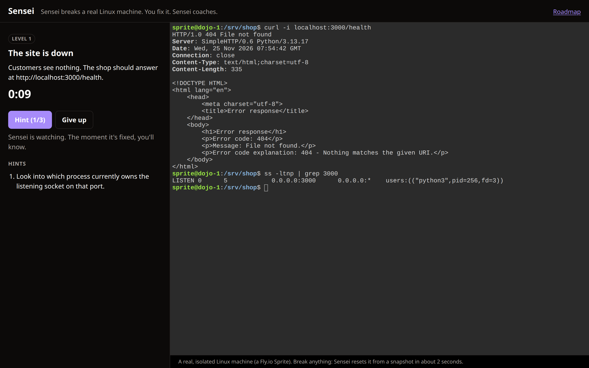
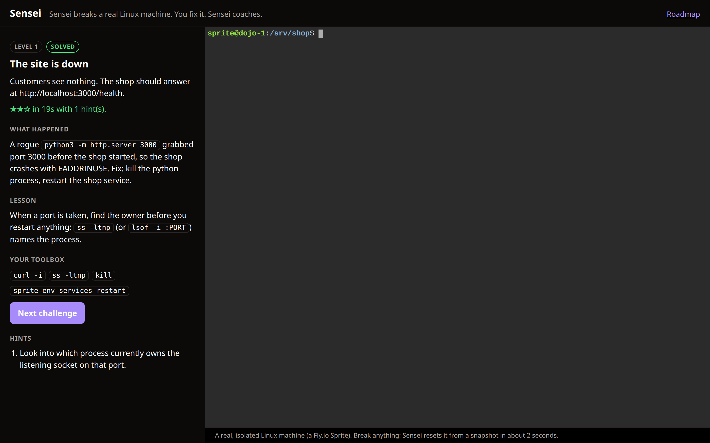
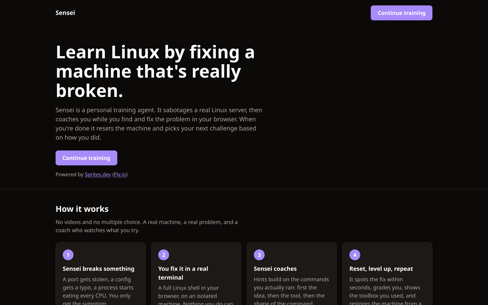
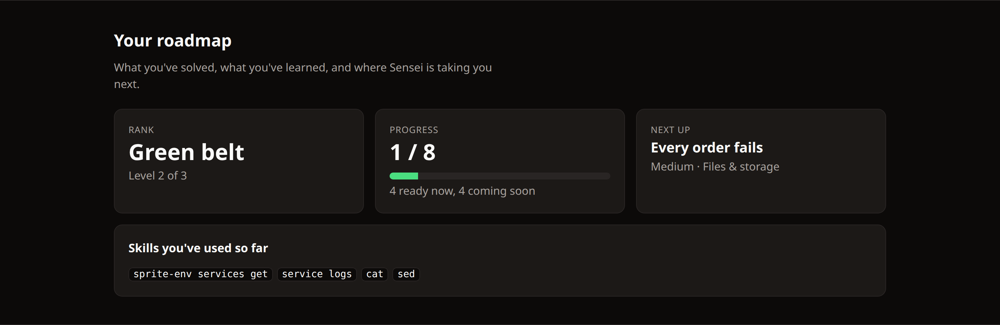
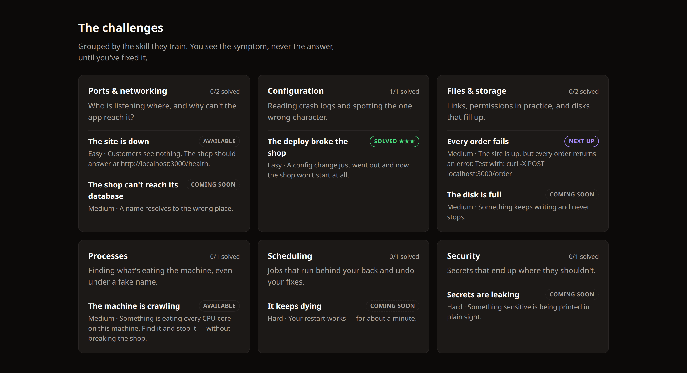
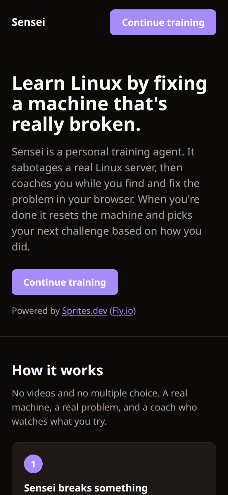

# Sensei

**Learn Linux by fixing a machine that's really broken.**

Sensei is a personal training agent. It sabotages a real Linux server, then coaches you while you find and fix the problem in your browser. When you're done, it resets the machine from a snapshot and picks your next challenge based on how you did.

**Live app:** https://shubu-sensei-b6vfx.sprites.app

> The landing page and roadmap are public. The dojo itself (the live terminal) is PIN-protected, because it is a real shell on a real machine.

---

## Screenshots

**Mid-challenge:** the shop is down. A real terminal on the right, Sensei's first hint on the left.



**Solved:** grade, what actually happened, the lesson, and the toolbox you used.



**Landing page and roadmap:** rank, progress, skills used so far, and what's next.





**Challenges by skill area:** you see the symptom, never the answer, until you've fixed it.





---

## How it works

1. **Sensei breaks something.** A port gets stolen, a config gets a typo, a process starts eating every CPU. You only get the symptom.
2. **You fix it in a real terminal.** A full Linux shell in your browser, on an isolated machine. Nothing you do can hurt anything else.
3. **Sensei coaches.** Hints build on the commands you actually ran, in three steps: first the idea, then the tool, then the shape of the command. They never hand you the fix.
4. **Reset, level up, repeat.** Sensei spots the fix within seconds, grades you (time and hints used), shows the toolbox you used, writes the result to your training journal, and restores the machine from a snapshot in about 2 seconds.

## Challenges

| Challenge | Skill area | Level | Status |
|---|---|---|---|
| The site is down | Ports & networking | Easy | Ready |
| The deploy broke the shop | Configuration | Easy | Ready |
| Every order fails | Files & storage | Medium | Ready |
| The machine is crawling | Processes | Medium | Ready |
| The shop can't reach its database | Ports & networking | Medium | Coming soon |
| The disk is full | Files & storage | Medium | Coming soon |
| It keeps dying | Scheduling | Hard | Coming soon |
| Secrets are leaking | Security | Hard | Coming soon |

Every breakage is scripted and verified: its check fails when the machine is broken and passes once it's fixed. The AI only chooses, coaches and grades; it never decides whether you succeeded.

## Architecture

```
 Browser ──► shubu-sensei (control Sprite)            dojo-1 (training Sprite)
             • landing page, roadmap, dojo UI          • the "shop" app (victim)
             • picks challenges, grades, levels up     • scripted breakages + checks
             • coaching via Ollama connector  ──────►  • watcher: is it fixed yet?
             • journal via GitHub connector            • browser terminal (ttyd)
             • snapshot / restore via Sprites API      • reset from snapshot in ~2 s
```

- **Two Sprites, on purpose.** The training machine gives the learner a real shell with admin rights, so it is a separate Sprite that can reach only the Ollama connector. It never sees the GitHub connector or the Sprites API token.
- **Snapshots are the game loop.** Each challenge starts from a clean, verified snapshot and ends by restoring it.
- **Rules decide, models describe.** Whether you fixed it is decided by a deterministic check. The model only writes hints, and each hint level has strict limits on what it may reveal.

## Sprites connectors used

- **Ollama:** open-weight model (`gpt-oss:120b`) for coaching. The API key lives in the Sprites gateway, never on a Sprite.
- **GitHub:** Sensei commits your training journal (`journal/sensei.md`) after every solved challenge.

## Open source stack

Node.js 24 (TypeScript, no build step) · [ttyd](https://github.com/tsl0922/ttyd) (MIT) for the browser terminal · [Ollama](https://ollama.com) with open-weight models · [ntfy](https://ntfy.sh) for phone notifications.

## Layout

```
sensei/server.ts     control app: landing page, dojo, challenge loop, coaching, journal
dojo/catalog.ts      challenges: symptom, hint ladder, hidden facts, lesson, skill area
dojo/challenges.sh   scripted breakages and checks (runs on the training machine)
dojo/watch.sh        reports whether the current challenge is fixed
dojo/terminal.sh     sets up the browser terminal (accessible DOM renderer) on a secret path
dojo/shop/server.js  the victim app
core/                shell, connector gateway, LLM, Sprites API client, ntfy, page shell
tools/               remote-exec helper, terminal test, commit-via-connector helper
```

## Running your own

1. Create two Sprites: a control Sprite and a training Sprite whose name is outside your connectors' access policy.
2. On the training Sprite, install the shop (`dojo/challenges.sh setup`), install [ttyd](https://github.com/tsl0922/ttyd) and run `dojo/terminal.sh <secret>` to serve it as a Sprite service on a secret path, then save a snapshot.
3. On the control Sprite, store a Sprites API token in `~/.config/hg/sprites-token` (mode 0600), add the Ollama and GitHub connectors, and run `node sensei/server.ts` as a Sprite service with:
   `HG_DOJO_SPRITE`, `HG_DOJO_GOLDEN` (snapshot id), `HG_DOJO_TERM` (terminal URL), `HG_PIN`, `HG_COOKIE_SECRET`, `HG_JOURNAL_REPO`, `HG_NTFY_TOPIC`, `HG_LLM=cloud`.

## License

MIT
